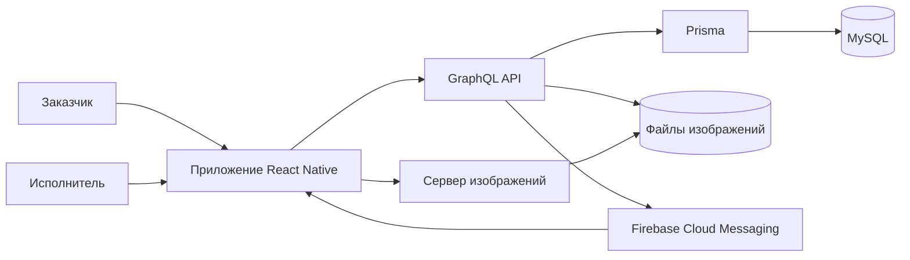

# Client Executor Mobile – CLEX

[English](README.md) | [Русский](README.ru.md)

Мобильное приложение на React Native с открытым исходным кодом для взаимодействия заказчиков и исполнителей в сфере полиграфии, сувенирной продукции и наружной рекламы.

Заказчики публикуют заказы и сравнивают предложения. Исполнители просматривают заказы по городам и категориям, предлагают цену и получают уведомления. Заказчик выбирает исполнителя, принимает или отклоняет работу. После завершения стороны могут обменяться отзывами.

Проект открыт для тестирования, вопросов и совместной разработки. Попробуйте сценарии заказчика и исполнителя, сообщайте о проблемах запуска и предлагайте улучшения через [Issues](https://github.com/proxymades/client-executor-mobile/issues). Как принять участие, описано в [руководстве для участников](CONTRIBUTING.ru.md).

## Возможности

- Отдельная навигация для заказчика и исполнителя.
- Заказы с фотографиями, количеством, категорией, городом и отметкой срочности.
- Предложения цены, выбор исполнителя, отмена и завершение работы.
- Профили, аватары и взаимные оценки.
- Русский и английский интерфейсы; светлая и тёмная темы.
- Firebase Cloud Messaging; локальное хранение сессии через MMKV.

## Архитектура



Сервер находится в репозитории [client-executor-server](https://github.com/proxymades/client-executor-server/blob/main/README.ru.md). Для локальной разработки разместите `client-executor-mobile` и `client-executor-server` рядом: тогда сервер сможет проверять все GraphQL-документы приложения командой `npm run check`.

## Технологии и требования

React Native 0.68.2, React 17, Apollo Client 3.6, React Navigation 6 и React Native Firebase 14.11.

Проверки JavaScript и сборки Metro выполнены с Node.js 22.21.1 и npm 10.9.4. Конфигурация Android использует target SDK 31. Совместимость с нативными инструментами сборки дорабатывается; текущие результаты приведены ниже.

## Локальный запуск

Клонируйте оба репозитория в одну родительскую папку:

```sh
git clone https://github.com/proxymades/client-executor-mobile.git
git clone https://github.com/proxymades/client-executor-server.git
cd client-executor-mobile
```

1. Запустите GraphQL-сервер на порту 4000 и сервер изображений на порту 5001. Настройка MySQL и создание демонстрационных аккаунтов описаны в README сервера.
2. Установите зависимости:

   ```sh
   npm ci
   npm run configure
   ```

   Команда `configure` создаёт исключённый из Git файл `config/local.json`, если он отсутствует. Существующую конфигурацию она не перезаписывает.

3. Настройте собственное приложение Firebase с bundle/application ID `kz.clex`:
   - Android: сохраните `google-services.json` в `android/app/`.
   - iOS: скачайте `GoogleService-Info.plist`, добавьте его в target `clex` в Xcode и инициализируйте Firebase в `AppDelegate` по инструкции React Native Firebase 14. Настройка Firebase для iOS и доставка push-уведомлений ещё требуют проверки на устройстве.
   - Файлы конкретного Firebase-проекта исключены из Git. Отправку push-уведомлений на сервере можно независимо отключить через `FIREBASE_ENABLED=false`.
4. Для физического устройства скопируйте `config/local.example.json` в `config/local.json` и замените пример IP на адрес компьютера с сервером в локальной сети. Для эмуляторов оставьте файл с содержимым `{}`: Android использует `10.0.2.2`, iOS – `localhost`.
5. Запустите Metro командой `npm start`; затем выполните `npm run android` либо настройте CocoaPods и выполните `npm run ios` с совместимыми нативными инструментами сборки.

Для физических устройств iOS используйте HTTPS: исходное исключение ATS разрешает HTTP только для localhost. Отладочный манифест Android разрешает локальный HTTP. Для релизных сборок нужны HTTPS и собственные настройки подписи; текущая конфигурация release использует отладочный keystore.

Адреса сервисов задаются в `config/default.json` и переопределяются локально в `config/local.json`. Эти файлы содержат только публичные URL, без серверных секретов.

## Проверки

```sh
npm run check
npm test -- --runInBand --watchman=false
npx react-native bundle --platform android --dev false --entry-file index.js --bundle-output /tmp/clex-android.bundle --assets-dest /tmp/clex-android-assets
```

Команда `check` проверяет синтаксис приложения, локальные импорты и URL в конфигурации. Семь тестов проверяют некорректные и истёкшие токены, состояние входа и выхода, основные действия исполнителя и восстановление после ошибки отправки предложения. Сборка Metro проверяет преобразование JavaScript и разрешение зависимостей; она не подтверждает нативную сборку или работу на устройстве.

Сервер требует JWT со сроком действия. Сессия длится семь дней; с прежними токенами без срока действия нужно войти снова. Ошибка регистрации Firebase-токена не препятствует входу.

## Скриншоты и состояние проверки

Настоящие скриншоты будут добавлены после запуска на устройстве или симуляторе. См. [список нужных кадров](docs/screenshots/README.ru.md).

Проверены JavaScript-сборки Android и iOS, тесты сессий и все 44 GraphQL-документа. Нативные сборки, разрешения камеры и фотографий, доставка FCM и полный сценарий двух аккаунтов ещё требуют проверки на устройствах. Восстановление пароля, подтверждение владения телефоном, удаление аккаунта и некоторые действия в настройках пока не реализованы. Ограничение частоты запросов API и эксплуатация в production также требуют дальнейшей работы.

Нативная iOS-сборка с установленным Xcode и SDK iOS 26.2 сейчас останавливается на Yoga.cpp:2232 (`-Werror,-Wbitwise-instead-of-logical`). Нативная Android-сборка ещё не проверена. Это открытые задачи разработки: проверки JavaScript сами по себе не подтверждают поддержку конкретной нативной среды.

## Ближайшие задачи разработки

- Проверить воспроизводимую Android-сборку и полный сценарий заказчика и исполнителя.
- Исправить совместимость с текущим Xcode и проверить iOS-сборку.
- Добавить настоящие скриншоты и демонстрационную сборку после проверки на устройстве.
- Упростить первый запуск и проверить push-уведомления.

Вопросы, сообщения об ошибках и pull requests приветствуются. Если запуск не удался, создайте issue с платформой, версиями инструментов, командой и текстом ошибки без секретных данных.

## Публикация

Перед публикацией история Git была очищена. В [PUBLISHING.ru.md](PUBLISHING.ru.md) записаны выполненные действия и проверки для дальнейших изменений.

## Лицензия

[ISC](LICENSE). Название CLEX сохранено как исходное имя проекта.
